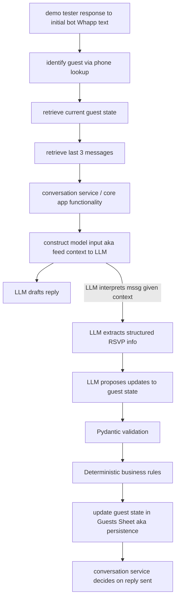
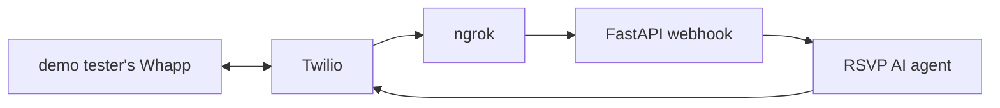

### orchestration layer in conversation module

|Definitions        |                                                         |
|:----------------  |:--------------------------------------------------------|
| Guest state       | The current RSVP information per guest stored by app    |
| LLM output        | model's interpretation of the guest's message           |
| Proposed update   | The structured change the LLM suggests 			      |
| Business rules    | Deterministic logic that decides y/n re proposed update |
| Message history   |	append only log of the conversation 			   	  |

## webhook workflow

